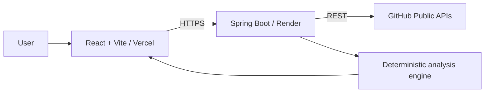

<div align="center">
  <h1>🎯 RepoRadar</h1>
  <p><strong>Scan. Analyze. Improve.</strong></p>
  
  <p>
    
    
    
    
  </p>

  <p><i>A production-ready developer productivity application that turns public GitHub repository data into an understandable health score, visual analytics, documentation findings, technology signals, and focused improvement suggestions.</i></p>
</div>

---

**RepoRadar** has no accounts, database, stored reports, or direct browser-to-GitHub calls. Paste a public repository URL and receive an analysis in seconds!

## ✨ Features

- 🛡️ **Safe & Secure:** Strict public GitHub URL validation and friendly, safe errors.
- 🚦 **Robust Backend:** Dedicated backend GitHub client with timeouts, one safe retry, rate-limit handling, and response transformation.
- 💯 **Health Scoring:** Deterministic, transparent 100-point repository health score.
- 📊 **Deep Insights:** Repository metadata, metrics, activity, community, branch, release, and contributor signals.
- 📝 **README Analysis:** Checklist with strengths, gaps, recommendations, and score.
- 🛠️ **Tech Stack Detection:** Technology detection from repository file paths, configuration, dependencies, and README text.
- 🎯 **Actionable Engine:** Project-structure insight and actionable recommendation engine.
- 📈 **Visual Dashboard:** Responsive React dashboard with Chart.js language donut.
- 📄 **PDF Export:** Professional browser-generated PDF report with summary, health score, language chart, and suggestions.
- 🚀 **Modern Setup:** Render health endpoint, CORS configuration, Vercel SPA routing, and environment-only API configuration.

## 🏗️ Architecture



> 📖 See the detailed [architecture documentation](docs/architecture.md).

## 💻 Technology Stack

| Area | Technology |
| :--- | :--- |
| **Backend** | Java 21, Spring Boot, Spring Web, Validation, Jackson, Lombok, Maven Wrapper |
| **Frontend** | React, Vite, Tailwind CSS, Axios, React Router, Chart.js, Lucide |
| **Report Export** | jsPDF (generated in the browser) |
| **Deployment** | Render (backend), Vercel (frontend) |
| **Data Source** | GitHub REST API |

## 📁 Project Structure

```text
RepoRadar/
├── backend/     
├── frontend/   
├── docs/        
├── render.yaml  
├── LICENSE
└── README.md
```

> 🗺️ For a complete map, read [docs/folder-structure.md](docs/folder-structure.md).

## 🚀 Run Locally

### 1. Clone and enter the project

```bash
git clone <your-repository-url>
cd RepoRadar
```

### 2. Configure the backend

Copy `backend/src/main/resources/application.properties.example` into your environment or set its variables in your shell. For local development, the essential values are:

```properties
PORT=8080
GITHUB_API_URL=https://api.github.com
GITHUB_TOKEN=
CORS_ALLOWED_ORIGINS=http://localhost:*,http://127.0.0.1:*
```

> 💡 *The supplied `application.properties` already provides safe local defaults; add `GITHUB_TOKEN` through your shell or IDE environment rather than committing it.*

**Windows PowerShell:**
```powershell
cd backend
$env:GITHUB_TOKEN = "optional-github-token"
.\mvnw.cmd clean install
.\mvnw.cmd spring-boot:run
```

**macOS/Linux:**
```bash
cd backend
export GITHUB_TOKEN="optional-github-token"
./mvnw clean install
./mvnw spring-boot:run
```
> The backend starts at `http://localhost:8080`. Confirm it with `http://localhost:8080/health`.

### 3. Configure and run the frontend

Create `frontend/.env` from the included example and set the local backend address:

```dotenv
VITE_API_BASE_URL=http://localhost:8080
```

**Windows PowerShell:**
```powershell
cd frontend
Copy-Item .env.example .env
npm install
npm run dev
```

**macOS/Linux:**
```bash
cd frontend
cp .env.example .env
npm install
npm run dev
```

> Open `http://localhost:5173`, paste a public repository URL such as `https://github.com/spring-projects/spring-boot`, and analyze it!

## 📡 API Documentation

| Endpoint | Method | Purpose |
| :--- | :---: | :--- |
| `/api/analyze?repositoryUrl={url}` | `GET` | Analyze a single public GitHub repository. |
| `/health` | `GET` | Service health and version for Render monitoring. |

> 📚 Complete request, response, status-code, and error documentation is in [docs/api.md](docs/api.md).
